<div align="center">

# 🎭 NickHider (Fabric 1.8.9)

**A modern, lightweight, and powerful client-side nickhider mod for Minecraft 1.8.9.**

Hide your real username, spoof any skin on-the-fly, conceal server-side `/nick` aliases, and protect your privacy while streaming or recording. Fully integrated with **OneClient** and **OneConfig**.

[](https://www.minecraft.net/)
[](https://fabricmc.net/)
[](https://polyfrost.org/)
[](LICENSE)
[](https://github.com/EdTrick)

<br/>

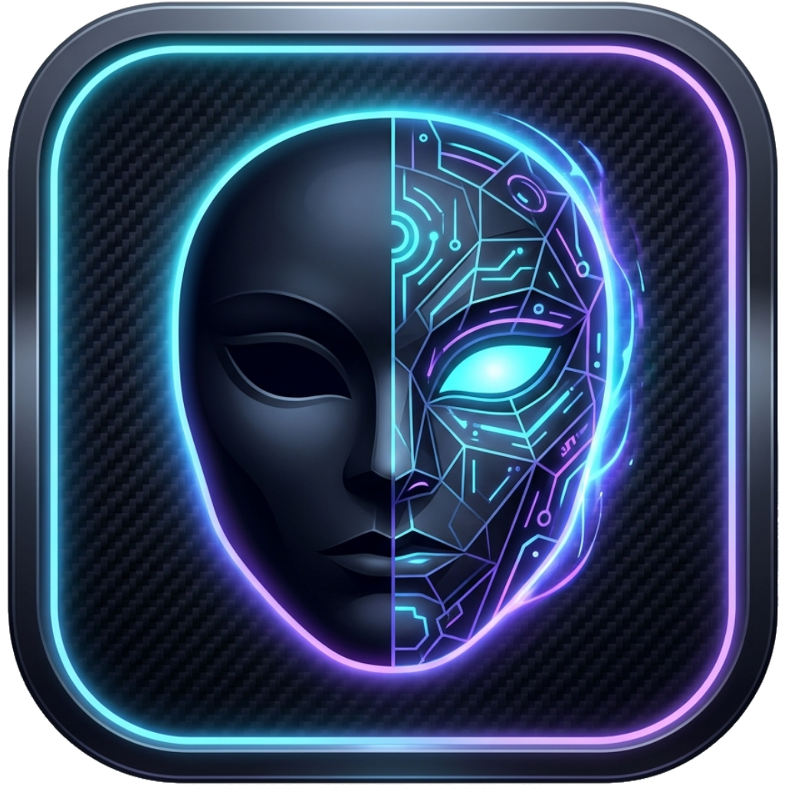

</div>

---

## 📖 Table of Contents

- [Overview](#-overview)
- [✨ Key Features](#-key-features)
  - [1. Advanced Nick Hiding](#1-advanced-nick-hiding)
  - [2. Instant Client-Side Skin Changer](#2-instant-client-side-skin-changer)
  - [3. Player Skull & Inventory Integration](#3-player-skull--inventory-integration)
  - [4. OneConfig & OneClient UI Support](#4-oneconfig--oneclient-ui-support)
  - [5. Interactive In-Game Commands & Autocompletion](#5-interactive-in-game-commands--autocompletion)
- [📸 Screenshots & Showcase](#-screenshots--showcase)
- [⌨️ Commands Reference](#️-commands-reference)
- [⚙️ Configuration](#️-configuration)
- [📦 Installation & Requirements](#-installation--requirements)
- [🛠️ Building from Source](#️-building-from-source)
- [🤝 Credits & Author](#-credits--author)
- [📄 License](#-license)

---

## 🔍 Overview

**NickHider** was engineered specifically for Minecraft 1.8.9 on Fabric / Ornithe / OneClient to give content creators, streamers, and competitive players complete control over their client-side identity.

Unlike legacy nick hiders that blindly replace entire lines of text (breaking scoreboard colors, team prefixes, health counters, or server-side `/nick` commands), **NickHider** uses surgical bytecode mixins that only replace your username where it matters, leaving all formatting, surrounding text, and server gameplay mechanics 100% intact.

---

## ✨ Key Features

### 1. Advanced Nick Hiding
- **Comprehensive Coverage:** Your real in-game name (IGN) is disguised seamlessly across:
  - 💬 **Chat & Private Messages** (incoming and outgoing)
  - 📋 **Tablist (Player List)**
  - 🏷️ **Nametags & Above-Head Displays**
  - 📊 **Scoreboards & Sidebars** (preserving team prefixes, health values, and styles)
  - 📜 **Holograms & Leaderboards**
  - 🎬 **Titles, Subtitles & Actionbars** (e.g. victory and win banners)
  - 🗂️ **Item Tooltips & Inventories**
- **Full Color & Style Code Support:** Custom nicknames support standard Minecraft color formatting (`&0` - `&f`) and styles (`&l` bold, `&o` italic, `&n` underline, etc.). Example: `&6&lEdTrick` or `&eE&bd&aTrick`.
- **Dynamic Server Nick Detection:** If you play on servers with their own `/nick` system (such as Hypixel, Minemen Club, etc.), NickHider automatically detects your randomized server nick and replaces it with your chosen fake nick everywhere.
- **Smart Preservation:** Does not break team prefixes, health icons, scoreboard points, or server ranks.

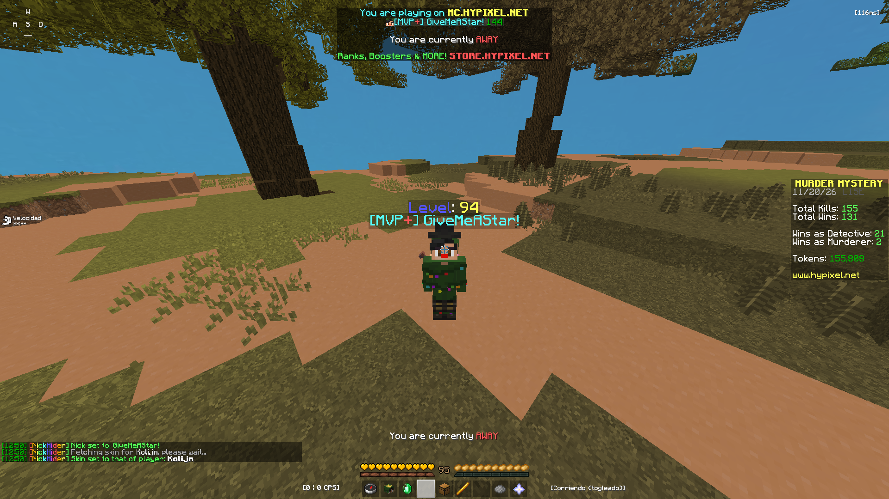

---

### 2. Instant Client-Side Skin Changer
- **Zero World Reconnects:** Switch skins dynamically in real time without having to rejoin the server or change dimensions.
- **High-Reliability Multi-Source API:** Fetches skins using an intelligent fallback pipeline (`PlayerDB` ➔ `Crafthead` ➔ `Mojang Session API`) to ensure 99.9% uptime and avoid rate-limiting.
- **Server Skin Override:** Overrides server-enforced skins (e.g. randomized skins given by server-side `/nick`) when a fake skin is set, and seamlessly restores your original account skin when disabled.
- **Supports Both Skin Models:** Works natively with both **Classic** (4-pixel Steve) and **Slim** (3-pixel Alex) skins.

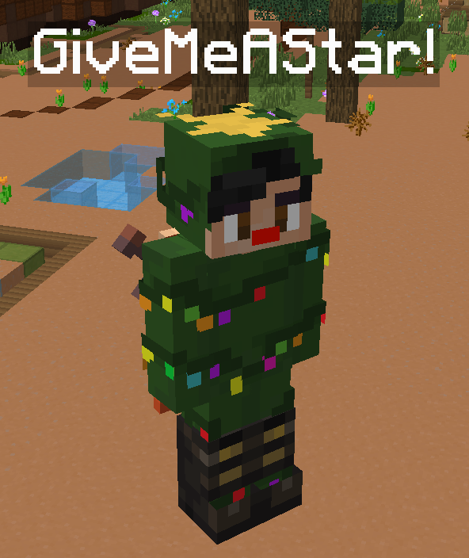

---

### 3. Player Skull & Inventory Integration
- **3D Skull Head Rendering:** Any player skull matching your player (in your inventory, hotbar, open chests, held items, armor/helmet slot, or placed in the world) automatically renders the 3D head of your fake skin.
- **Display Name Localization:** Player skull items dynamically display your fake nickname (e.g. `EdTrick's Head` instead of your real IGN).

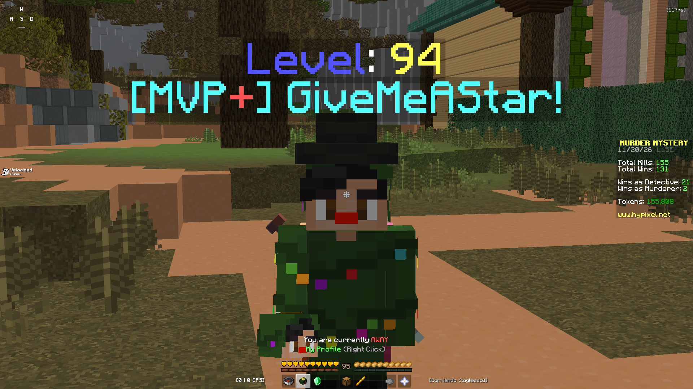

---

### 4. OneConfig & OneClient UI Support
- **Native OneConfig Menu:** Configurable directly via the OneConfig graphical menu (`Right Shift`). Found under **Visuals ➔ NickHider**.
- **Intuitive Toggles:** Independent `Enable Nick Hider` and `Enable Skin Hider` switches with dedicated text inputs for instant adjustments.
- **OneClient Sidebar Account Protection:** Replaces your real account name in the bottom-left corner of the OneClient mod menu (next to your skin avatar) without interfering with Mojang authentication or PolyPlus session tokens.

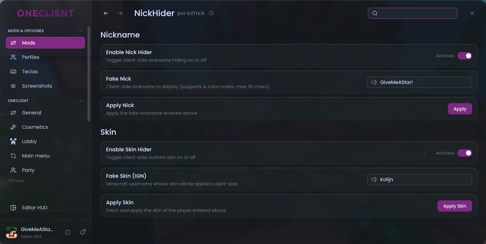

---

### 5. Interactive In-Game Commands & Autocompletion
- **Full Tab-Completion:** Press `Tab` on `/nick<TAB>` or `/nickhider<TAB>` to complete all subcommands and parameters.
- **Clickable Chat Menu:** Running `/nickhider help` prints an elegant, numbered list of commands with hover descriptions and click-to-prepare suggestions.

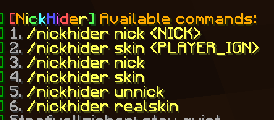

---

## 📸 Screenshots & Showcase

| Feature | Demonstration |
| :--- | :--- |
| **In-Game Tablist & Chat** | 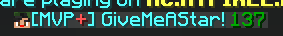 |
| **Scoreboard & Nametags** | 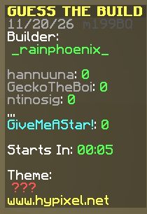 |
| **Titles & Subtitles** |  |
| **Holograms & Leaderboards** | 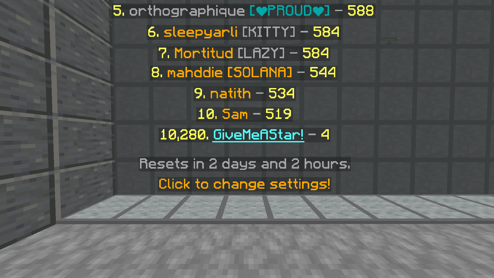 |
| **Inventory & Player Skulls** | 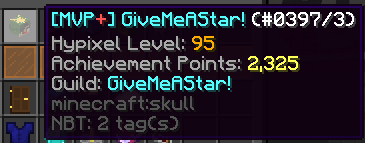 |
| **OneConfig Menu Interface** |  |
| **OneClient Sidebar** | 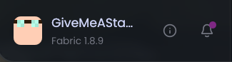 |

---

## ⌨️ Commands Reference

You can use `/nickhider`:

| Command | Description | Example |
| :--- | :--- | :--- |
| `/nickhider nick <name>` | Sets a fake client-side nickname (supports `&` color codes) | `/nick nick &6&lEdTrick` |
| `/nickhider unnick` | Resets nickname back to your real account name | `/nick unnick` |
| `/nickhider skin <player>` | Sets your client-side skin to any Minecraft player's skin | `/nick skin Kolijn` |
| `/nickhider realskin` | Resets skin back to your real account skin | `/nick realskin` |
| `/nickhider help` | Displays the interactive command help menu | `/nick help` |

> [!TIP]
> You can click on any command in the `/nickhider help` chat message to auto-fill it directly into your chat bar!

---

## ⚙️ Configuration

NickHider stores its settings in two locations depending on whether you use OneConfig:

1. **Standard Configuration File:**
   - Located at: `.minecraft/config/nickhider/nickhider.properties`
   - Properties:
     ```properties
     # NickHider configuration by EdTrick
     fakeNick=&6&lEdTrick
     fakeSkin=Kolijn
     ```
2. **OneConfig GUI:**
   - Press **Right Shift** (or your OneConfig menu keybind).
   - Navigate to **Visuals ➔ NickHider**.
   - Toggle switches or enter nicknames/skins in real-time. Changes save automatically!

---

## 📦 Installation & Requirements

### Requirements:
- **Minecraft:** `1.8.9`
- **Mod Loader:** [Fabric Loader (0.15+)](https://fabricmc.net/) or [Ornithe](https://ornithemc.net/) / [Polyfrost OneClient](https://polyfrost.org/)
- **Java:** `Java 8` or higher
- *(Optional)* [OneConfig](https://polyfrost.org/) for the graphical in-game settings menu.

### Installation Steps:
1. Download the latest `nickhider-x.x.x.jar` from the [Releases](https://github.com/EdTrick/nickhider-fabric-1.8.9/releases) tab.
2. Place the downloaded `.jar` file into your `.minecraft/mods` folder (or your OneClient cluster `mods` folder).
3. Launch Minecraft 1.8.9 with Fabric / OneClient.

---

## 🛠️ Building from Source

To compile the mod from source code:

1. Clone the repository:
   ```bash
   git clone https://github.com/EdTrick/nickhider-fabric-1.8.9.git
   cd nickhider-fabric-1.8.9
   ```

2. Build using the Gradle wrapper:
   - **Windows:**
     ```cmd
     .\gradlew.bat build
     ```
   - **Linux / macOS:**
     ```bash
     ./gradlew build
     ```

3. The finished `.jar` file will be located in `build/libs/nickhider-1.0.0.jar`.

---

## 🤝 Credits & Author

- **Author & Developer:** **EdTrick**
  - GitHub: [@EdTrick](https://github.com/EdTrick)
- Built with **Fabric Loom**, **Ploceus** (Ornithe MCP mappings for 1.8.9), and **OneConfig API**.

---

## 📄 License

This project is licensed under the **MIT License**. See the [LICENSE](LICENSE) file for more details.

<div align="center">
  <sub>Crafted by <b>EdTrick</b> for Minecraft 1.8.9</sub>
</div>
